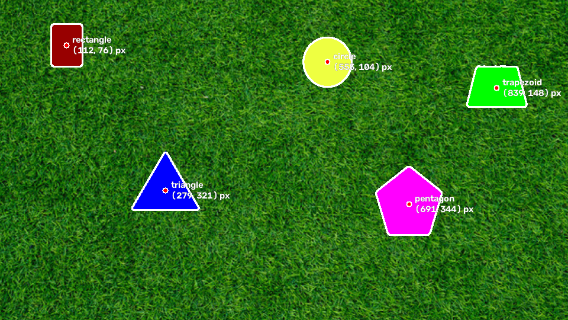
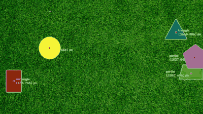
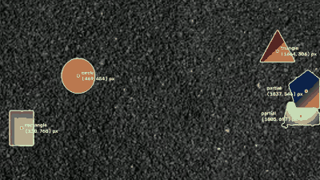
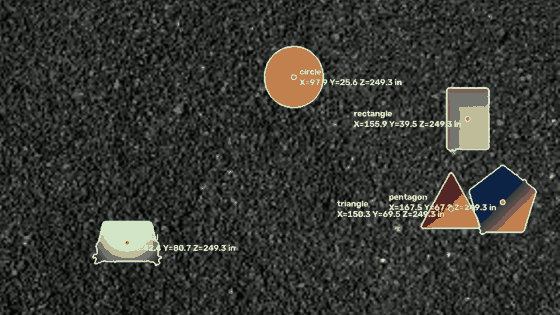

# Background-Agnostic Shape Detection

Detects solid shapes on a textured background, traces their outlines, marks their centres,
works on streamed video, is agnostic to background and fill gradients, and estimates each
centre's 3D position from the camera intrinsics (Parts 1–4).



| Part | Output |
|---|---|
| 1. Static image | [`results/static_detected.png`](results/static_detected.png) |
| 2. Video (grass) | [`results/dynamic_detected.mp4`](results/dynamic_detected.mp4) · preview below |
| 3. Background agnostic (gravel, gradient fills) | [`results/dynamic_hard_detected.mp4`](results/dynamic_hard_detected.mp4) · preview below |
| 4. 3D positions | [`results/dynamic_hard_3d.mp4`](results/dynamic_hard_3d.mp4), [`results/static_3d.png`](results/static_3d.png), per-frame log [`results/dynamic_hard_3d.csv`](results/dynamic_hard_3d.csv) |

| Grass (Part 2) | Gravel + gradient fills (Part 3) |
|---|---|
|  |  |

**3D positions (Part 4)**



*Previews are short, downsampled GIF clips. The full-length recordings are the `.mp4` files linked
above. They are written directly by `detect_video.py` from every processed frame rather than
screen-captured, so they show exactly what the algorithm output, at the source frame rate.*

## Running it

```bash
python3 -m venv .venv && source .venv/bin/activate
pip install -r requirements.txt

# Put the challenge files in media/ (not committed; dynamic.mp4 is ~100 MB):
#   media/static.png  media/dynamic.mp4  media/dynamic_hard.mp4

python detect_image.py media/static.png -o results/static_detected.png          # Part 1
python detect_video.py media/dynamic.mp4 -o results/dynamic_detected.mp4        # Part 2
python detect_video.py media/dynamic_hard.mp4 -o results/dynamic_hard_detected.mp4   # Part 3
python detect_video.py media/dynamic_hard.mp4 -o results/dynamic_hard_3d.mp4 --3d --csv results/dynamic_hard_3d.csv  # Part 4
```

Add `--show` to watch live. `python tools/evaluate.py` reproduces the accuracy numbers below.

## Approach

### The key observation: texture, not colour

A colour rule ("anything that isn't green is a shape") breaks immediately: the static image has
a **green trapezoid on green grass**, and the hard video swaps grass for grey gravel and fills the
shapes with gradients, including a white-to-dark-grey trapezoid whose lower corners are almost the
colour of the gravel.

What every frame does have in common is that **backgrounds are rough at small scales and shapes are
smooth**, even the gradient-filled ones. So the detector segments by local texture and only uses
colour at the very end, to place edges precisely. Nothing in it is tuned to grass or gravel.

### Pipeline (`shapes/detector.py`)

1. **Downscale** 1920×1080 frames to 960×540 for speed.
2. **Texture map.** Subtract a Gaussian-blurred copy of the frame (σ = 1.5 px) and average the
   absolute residual over a 7×7 window, per Lab channel, keeping the maximum. Blurring leaves slowly
   varying shading unchanged (a linear ramp exactly so), so a shape's gradient fill leaves almost no
   residual, while grass and gravel leave a lot.
3. **Seeds with hysteresis.** Seeds are pixels whose texture is below 0.3 × the frame's median
   texture. Using a *ratio to the median* is what makes the threshold adapt to each background. Seeds
   then grow through pixels below 0.5 × median, but only where connected to a seed (like Canny's two
   thresholds), so a shape absorbs its own slightly rough gradient bands without picking up smooth
   patches of background. Tiny blobs (< 0.1% of the frame) are discarded.
4. **Watershed refinement.** The texture window shrinks every seed by a few pixels at its edge, so a
   watershed decides an 8-px band around each region. It meets the background at the strongest colour
   edge, snapping the outline onto the true boundary. A 7×7 median filter first flattens grass blades
   while keeping straight step edges, so outlines don't leak on weak edges (green on grass).
5. **Outline, centre, label.**
   - The outline is traced again on the region mask *upsampled to full resolution*, so the edge keeps
     its sub-pixel position.
   - **Centre = centroid of the region** (image moments m10/m00, m01/m00).
   - The label comes from the convex hull: circles by circularity 4πA/P² > 0.96; otherwise corners
     are counted by turning angle (a convex outline turns 360° in total, so 3×120° = triangle,
     4×90° = rectangle, 5×72° = pentagon). Rectangles and trapezoids are told apart by whether both
     pairs of opposite sides are parallel. Shapes cut off by the frame edge or with concave outlines
     (partly hidden behind another shape) are labelled `partial`.

### Streaming (Part 2)

`detect_video.py` reads one frame at a time with `cv2.VideoCapture.read()` and processes it before
reading the next, so the algorithm never sees future frames, the same way an aircraft receives its
camera feed. Detection itself is stateless. The only state carried between frames is in 3D mode: the
last accepted depth (reused while the circle is hidden) and the last 15 depths for the consistency
gate described in Part 4.

### Background agnosticism (Part 3): what changed

The first version already avoided colour thresholds, but it needed four changes before the gravel
video with gradient-filled shapes worked. No parameter differs between the grass and gravel runs.

| Change | Why it was needed |
|---|---|
| Texture measured as blur residual instead of local standard deviation | A smooth brightness ramp (the white trapezoid) scored as rough as gravel, and the shape lost half its area |
| Thresholds as ratios of the frame's median texture | Grass and gravel have very different absolute texture, but shapes sit far below the median in both |
| Hysteresis growth from strict seeds into "fairly smooth" pixels | Parts of gradient fills where the colour turns sharply are slightly rough and fell just above the seed threshold |
| 8-px refinement band, with a median filter before the watershed | A 5-px band cut off the rectangle's magenta edge strip; widening it alone let outlines leak on weak edges (green on grass), which the median filter stopped |

### 3D positions (Part 4, `shapes/camera.py`)

Pinhole model in the OpenCV camera frame (X right, Y down, Z out of the lens):
u = fx·X/Z + cx, v = fy·Y/Z + cy.

1. **Depth from the circle.** A circle of radius R = 10 in at depth Z appears with pixel radius
   r = f·R/Z, so **Z = f·R/r**, with f = √(fx·fy). The pixel radius comes from a least-squares circle
   fit to the outline (x² + y² = 2ax + 2by + c is linear in a, b, c), refit in two stages: first
   dropping points well *inside* the rim (the straight cut where another shape covers part of the
   circle), then dropping points well off the rim either way (a bulge where the outline leaked into a
   touching shape). On frames where the circle is partly hidden this keeps depth at 247–252 in instead
   of jumping to 268 in.
   A **consistency gate** then rejects a single-frame depth jump of more than 3% from the median of the
   last 15 accepted depths, keeping the previous value; after 5 rejections in a row the new value is
   accepted, so a real change in height still gets through. It uses past frames only, so it is still a
   streaming algorithm. It exists for one kind of frame the fit can't fix: an orange-red triangle's
   corner poking out from under the orange-red circle, which read 230 in.
2. **Flat surface.** All shapes lie on one plane facing the camera, so every centre shares the
   circle's depth.
3. **Back-project** each centre: X = (u − cx)·Z/fx, Y = (v − cy)·Z/fy.

Assumptions worth flagging:
- **The given K has cx = cy = 0**, which puts the optical axis through the *top-left pixel* rather than
  the image centre (real cameras have cx ≈ width/2). The default uses K exactly as given;
  `--principal-point center` uses (960, 540) instead. Z is the same either way; only X and Y shift.
- K is assumed to be calibrated at the videos' 1920×1080; for the 960×540 static image it is scaled
  by ½, which leaves Z unchanged (f and r both halve).

## Results

### Static image

| Shape | Centre (px) | X (in) | Y (in) | Z (in) |
|---|---|---|---|---|
| rectangle | (112.5, 76.0) | 27.4 | 18.5 | 312.0 |
| circle | (553.0, 104.4) | 134.6 | 25.4 | 312.0 |
| trapezoid | (839.2, 148.1) | 204.2 | 36.0 | 312.0 |
| triangle | (279.3, 320.5) | 68.0 | 77.8 | 312.0 |
| pentagon | (690.6, 343.8) | 168.1 | 83.5 | 312.0 |

### Videos

| | Grass (Part 2) | Gravel + gradients (Part 3) |
|---|---|---|
| Frames processed (streamed, one at a time) | 1837 | 1841 |
| Frames with all 5 shapes found | 1316 | 1269 |
| Frames with fewer (shapes overlapping) | 521 | 569 |
| Frames with an extra region | 0 | 3 (a hidden shape split into two visible pieces) |

**Speed.** Detection on a 1920×1080 frame takes **18.5 ms on average (p95 19.6 ms), about 54 fps**, on
an Apple M5 laptop CPU (clean benchmark of 120 frames), comfortably faster than the videos' 30 fps.
While also drawing and encoding output video, the full runs averaged 19.6–21.4 ms per frame.

**Depth (Part 4).** In both videos the camera stays at a fixed height above the plane, so the circle's
depth should be constant, which makes a good self-check. Over the 1167 gravel-video frames where the
circle is visible: **median Z = 249.5 in, standard deviation 0.48 in, range 246.4–252.1 in, 99.6% of
frames within ±1% of the median**, including frames where another shape covers part of the circle.
In the other 674 frames the circle is cut off by the frame edge or hidden, and the last accepted depth
is reused.

### Measured accuracy (`tools/evaluate.py`)

Eyeballing overlays is not a measurement, so accuracy is scored against ground truth:

- In the easy video every shape is **one flat colour**, so its true mask can be recovered by colour
  matching (pixels within ±10 of the shape's colour, largest connected piece, holes filled).
- **Both videos move identical shapes along identical paths**; only background and fill differ. So
  the same masks are ground truth for the *hard* video too, which has no flat colours to match.

Over 31 frames (every 60th, 144 shapes per video):

| Video | Mean IoU | Worst IoU | Mean centre error | Worst centre error |
|---|---|---|---|---|
| Grass | **0.969** | 0.918 | **0.32 px** | 1.8 px |
| Gravel + gradients | **0.957** | 0.386 | **1.39 px** | 69.9 px |

The gravel video's worst cases all come from a single frame (1740), where two overlapping shapes
merged into one region (see Limitations). IoU is measured at 1920×1080.

Labels, on sampled frames where all five shapes are whole (not overlapping or cut off):
18 of 19 frames fully correct on grass, 13 of 15 on gravel.

## Challenges, and what didn't work

- **Plain local standard deviation as the texture measure.** It worked on grass, but on the hard
  video a clean brightness ramp scored as rough as gravel, and the white trapezoid lost half its area.
  Measuring texture *after subtracting a blur* fixed it: inside that ramp the texture dropped to 0.85,
  against a seed threshold of ~2.1.
- **A 1-px dilation and ×2 contour scaling.** Tracing outlines at half resolution and multiplying by 2
  put them ~2.5 px outside the true edge at 1080p (found by measuring signed offset against ground
  truth). Counting the watershed line as half inside and re-tracing on an upsampled mask raised mean
  IoU on the grass video from 0.946 to 0.966, with no other change.
- **`approxPolyDP` for shape labels.** Rounded and bevelled pixel corners kept adding or dropping
  vertices, and on a closed outline it always keeps its start point, so the best 4-point fit of a
  rectangle covered only 86% of it. Turning-angle corner counting replaced it.
- **Checking corners before circularity.** Meant to stop a bulging pentagon being called a circle, it
  made real circles "triangles" (unevenly spaced hull vertices grouped into three turns). The fix was
  a stricter circularity cut-off from measurements: circles score 0.99+, the bulging pentagon ~0.93.
- **Circle radius from area, then from the minimum enclosing circle.** r = √(A/π) shrinks when another
  shape covers part of the circle, so depth jumped from ~250 to 268 in on 29 frames. The minimum
  enclosing circle ignores the hidden part but is inflated by extreme outline pixels, reading 3% large
  even on a whole circle. The iterative rim fit gets both cases right.
- **Using the easy video's detections as ground truth.** The green-on-green trapezoid's outline leaked
  a little into the grass, so the "hard" trapezoid looked 5% too small when the easy one was actually
  too big. Building ground truth from colour matching instead of detections removed that bias.

## Efficiency

Measured on 1920×1080 frames of the gravel video (Apple M5 laptop CPU, averaged over 60 frames):

| Choice | Measured effect |
|---|---|
| Process at 960×540 instead of 1920×1080 | **≈19 ms vs 74 ms per frame** (≈54 fps vs 14 fps, and 14 fps would fall behind the video's 30 fps). The downscale itself costs 0.1 ms. Outlines are re-traced at full resolution only inside each shape's bounding box, so accuracy is still measured at 1080p. |
| Box filter for the texture window | 0.82 ms at 7×7 and 0.85 ms at 31×31: the cost doesn't grow with window size. A general 7×7 convolution takes 2.95 ms. |
| Median filter before the watershed | 0.6 ms, the cost of stopping outlines leaking on weak edges |
| No per-pixel Python loops | Each frame is a handful of OpenCV calls plus one Python loop over ~5 regions |

The texture map is the largest single cost (8.2 ms, about 44% of the frame), so it would be the first
thing to move to a GPU or a smaller processing width if the aircraft's computer needed more headroom.

## Limitations

- **Overlapping shapes.** When two gradient shapes overlap on gravel, their seeds can join into one
  region (frame 1740: the white trapezoid over the rectangle). A partly hidden shape whose visible part
  is still convex can also get the wrong label. Tracking shapes through overlap is Part 6.
- **Very weak edges.** The white trapezoid's dark lower corners are nearly gravel-coloured, and the
  outline can bulge there by a few pixels, occasionally adding a fifth "corner".
- **Flat, fronto-parallel plane** for depth; a tilted camera would need the plane's orientation too.
- The detector has ~8 parameters, chosen by sweeping them against the ground-truth score above rather
  than by eye; they are all ratios or pixel sizes at 960 px width, not background-specific values.

## Layout

```
shapes/detector.py    Parts 1-3: texture map, seeds, watershed, outlines, labels
shapes/camera.py      Part 4: depth from the circle, back-projection with K
shapes/draw.py        overlay drawing
detect_image.py        run on one image
detect_video.py        run on a video as a stream; timing, per-frame CSV
tools/evaluate.py      IoU / centre error against colour-matched ground truth
results/               output images, videos, logs
```
